<p align="center">
  
</p>
<h1 align="center">multi-split</h1>
<p align="center">
  <b>Панель для своей сети VPN-серверов на 3x-ui</b><br>
  умный сплит по доменам · несколько выходов · резервный сервер с переездом · мониторинг · бэкапы · обновления из интерфейса
</p>
<p align="center">
  <a href="https://github.com/nuxtcloud/prxy-panel/releases/latest"></a>
  <a href="LICENSE.md"></a>
  
  
</p>

<p align="center">
  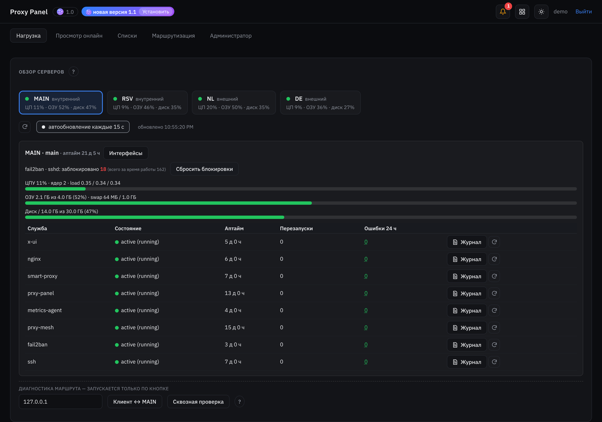
</p>

*A self-hosted control panel for a network of 3x-ui VPN servers: per-domain smart routing, multiple exit servers, a standby main server with failover, monitoring, encrypted backups and in-app updates. Interface language: Russian. License: PolyForm Noncommercial 1.0.0.*

> Здесь публикуются релизы: архив для установки — в разделе [Releases](https://github.com/nuxtcloud/prxy-panel/releases). Исходный код находится внутри архива.

> Статус: **бета**. Проект работает в реальной эксплуатации, но установка с нуля на чужих серверах проверена меньше, чем обновления. Перед установкой сделайте снимок сервера у хостера.

## Зачем

3x-ui хорошо управляет одним сервером. Когда серверов несколько, начинается ручная работа: какой сайт вести через какую страну, что делать, если главный сервер упал, как обновить всё разом и не открыть панели всему интернету. multi-split берёт это на себя:

- **Каждое соединение решается по домену.** Свои сайты идут напрямую с главного сервера (быстро и без лишних хопов), остальное — через выбранный внешний сервер. Решают ручные правила, списки, кэш проверок доступности и, если нужно, логика профиля на Python.
- **Несколько стран сразу.** Маршруты `TUNNEL-NL`, `TUNNEL-DE`… и профили MULTI-SPLIT: видео через одну страну, ИИ-сервисы через другую, банки напрямую.
- **Главный сервер можно потерять.** Резервный держит выключенную копию всего и свежую зашифрованную копию данных; переезд — кнопкой или сам, когда наблюдатели в кольце резерва видят, что главный пропал.
- **Ничего лишнего наружу.** Панель и 3x-ui — за секретным путём и паролем nginx, все службы на `127.0.0.1`, посторонние видят обычный сайт.
- **Одна кнопка на обновление.** Панель сама видит новый релиз на GitHub и ставит его на все серверы.

## Как устроено

<picture>
  <source media="(prefers-color-scheme: dark)" srcset="docs/img/topology-dark.png">
  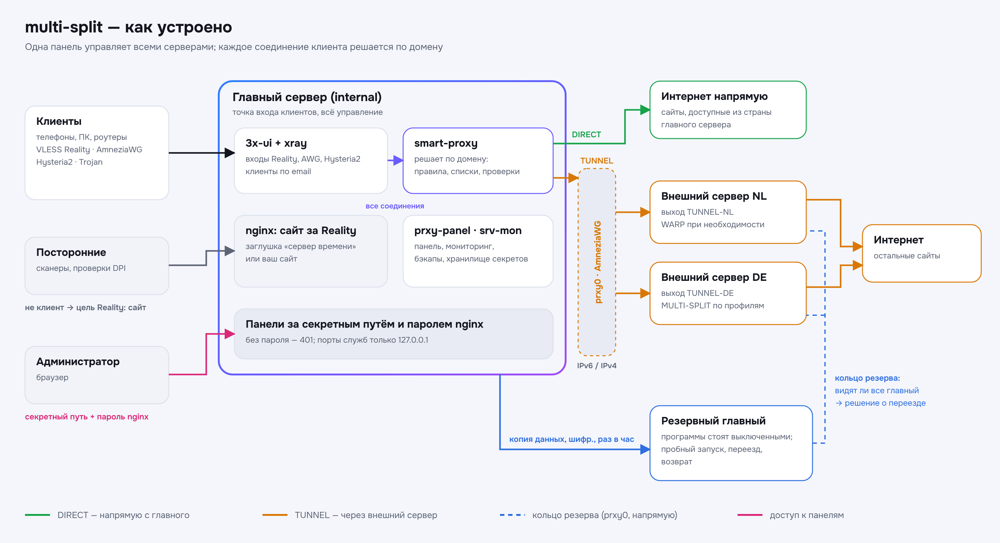
</picture>

- **Главный (internal)** — сюда подключаются клиенты: 3x-ui (входы Reality, AmneziaWG, Hysteria2), smart-proxy, панель.
- **Внешние (external)** — выходы в интернет других стран. Панель сама ставит на них всё нужное по SSH.
- **Резервный (internal)** — запасной главный: программы стоят выключенными до переезда.
- **prxy0** — туннель между серверами на AmneziaWG: снаружи IPv6 или IPv4 (у каждого сервера свой режим, с запасным путём), внутри адреса `10.77.0.x`.

## Возможности в картинках

<table>
<tr>
<td width="50%">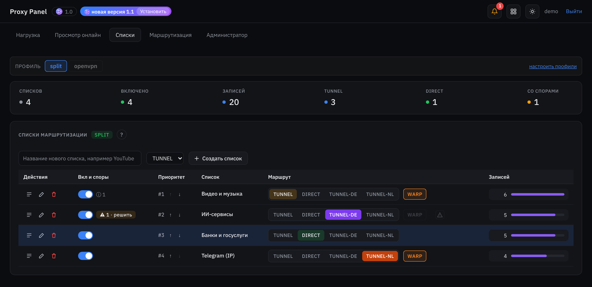<br><b>Списки маршрутизации.</b> Группы доменов и подсетей со своим маршрутом: напрямую, TUNNEL по умолчанию, конкретная страна, WARP.</td>
<td width="50%">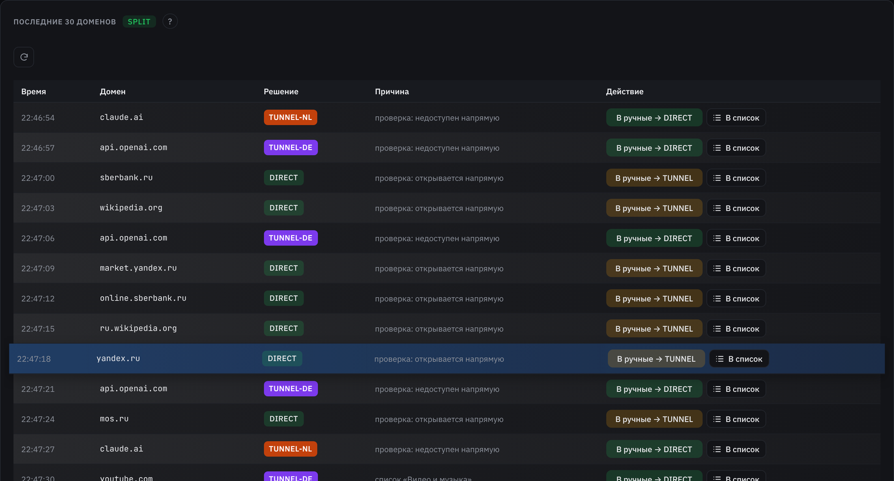<br><b>Домены в реальном времени.</b> Куда пошло каждое соединение и почему — правило, список, проверка доступности. Перевести в правило — одна кнопка.</td>
</tr>
<tr>
<td>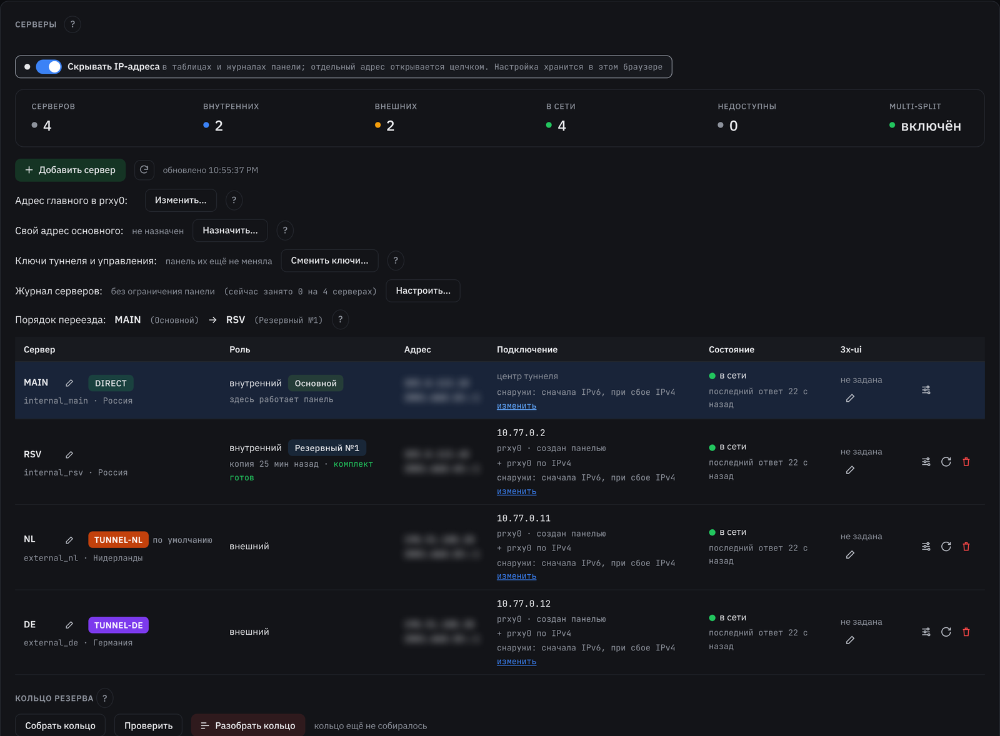<br><b>Серверы.</b> Главный, внешние и резервный в одной таблице: туннель, режим транспорта, состояние, порядок переезда. Адреса скрываются одним переключателем.</td>
<td>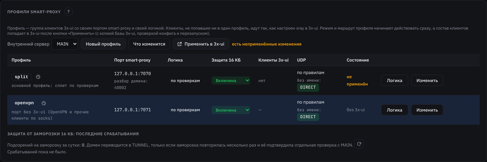<br><b>Профили smart-proxy.</b> Группы клиентов 3x-ui со своей логикой: по проверкам, фиксированный маршрут или свой скрипт.</td>
</tr>
<tr>
<td>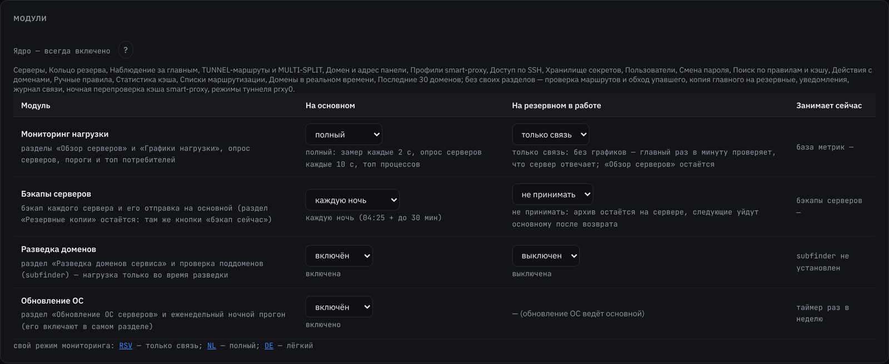<br><b>Модули.</b> Мониторинг, бэкапы, разведка доменов, обновления ОС — облегчить или выключить, отдельно для главного и резервного.</td>
<td>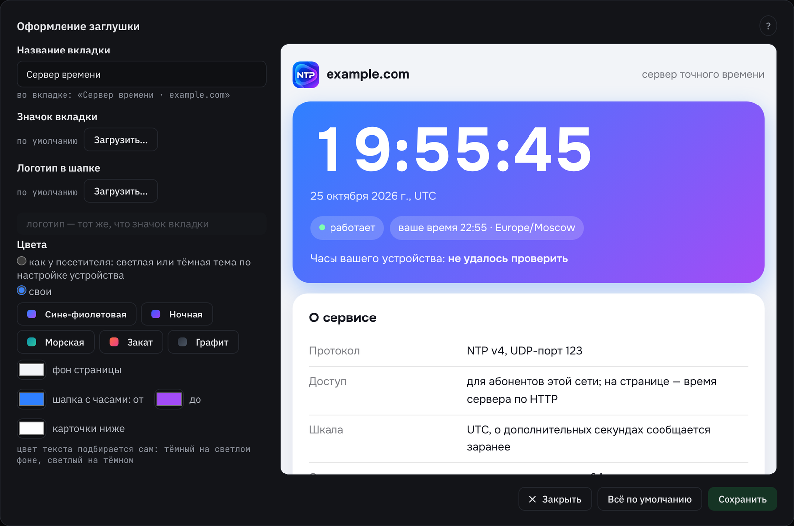<br><b>Сайт за Reality.</b> Если сайта-прикрытия нет, панель разворачивает свою страницу-заглушку; оформление настраивается с предпросмотром.</td>
</tr>
<tr>
<td>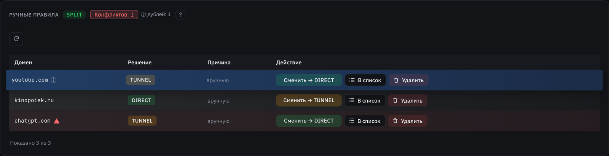<br><b>Ручные правила и кэш.</b> Конфликты и дубли подсвечиваются, правило можно перепроверить, перенести в список или удалить.</td>
<td>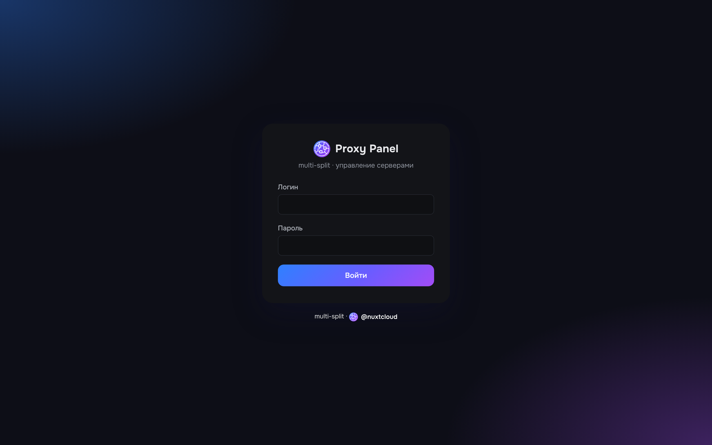<br><b>Вход.</b> Страница входа доступна только после пароля nginx; при первом входе панель просит завести своего администратора.</td>
</tr>
</table>

<details><summary>Светлая тема</summary>

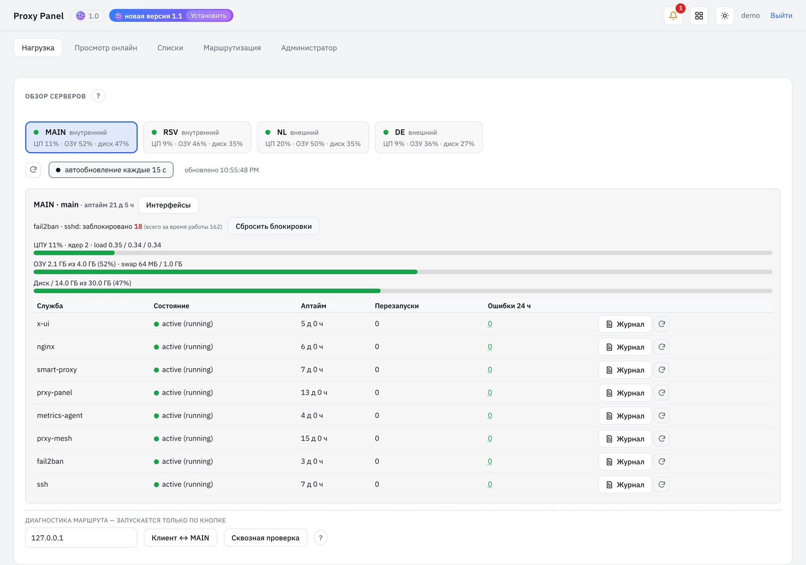
</details>

<sub>Скриншоты сделаны на демо-стенде с вымышленными серверами и адресами.</sub>

## Что ещё умеет

- **Клиенты AmneziaWG** разбираются по доменам так же, как клиенты Reality (имя берётся из их DNS-запросов); отдельным подключениям можно включить «ускоренную обработку» мимо smart-proxy.
- **Пробный запуск резервного**: копия главного раскладывается и проверяется, клиенты при этом остаются на главном.
- **Мониторинг и уведомления**: нагрузка каждого сервера (полный, лёгкий, только связь; замеры можно держать в памяти), службы, журналы, диск.
- **Бэкапы** с шифрованием открытым ключом хранилища, полный бэкап главного, расписание.
- **Хранилище секретов**: ключи SSH, токены DNS и прочее — в зашифрованном виде; пароли от серверов используются один раз и не сохраняются.
- **Обновления ОС серверов** по очереди, с проверками.
- **Раскладка интерфейса**: разделы перетаскиваются по вкладкам, у каждого раздела есть «?» с объяснением.

## Требования

- **Главный сервер:** Ubuntu 22.04 или 24.04 (Debian 12 — должно работать), 1 ГБ памяти и больше, root-доступ.
- **3x-ui уже установлен и работает** (https://github.com/MHSanaei/3x-ui), в нём настроен вход Reality. `install.sh` 3x-ui и xray не ставит, только проверяет.
- **AmneziaWG** на главном (утилита `awg` и модуль ядра или `amneziawg-go`) — для туннеля между серверами. Ubuntu: `sudo add-apt-repository ppa:amnezia/ppa && sudo apt install amneziawg`.
- **Домен** с сертификатом, если хотите открывать панель по адресу за Reality (иначе — через SSH-туннель).
- **Внешние и резервные серверы:** Ubuntu или Debian с доступом по SSH; всё остальное панель поставит сама.

## Установка

1. Скачайте архив последнего релиза (https://github.com/nuxtcloud/prxy-panel/releases/latest) на главный сервер и распакуйте:
   ```bash
   tar xzf multi-split-<версия>.tar.gz && cd multi-split-<версия>
   ```
   Проверка архива: `sha256sum -c multi-split-<версия>.tar.gz.sha256`.
2. Запустите установку:
   ```bash
   sudo bash install.sh
   ```
   Скрипт спросит имя сервера (до 4 знаков, например `MAIN`) и режимы модулей; `--yes` — всё по умолчанию, `--help` — все параметры.
3. В конце скрипт **один раз** покажет:
   - временный логин и пароль панели (при первом входе панель попросит завести своего администратора);
   - логин и пароль nginx и секретный путь панели.

   Сохраните их в менеджере паролей.

### Вход в панель

- **Сайт за Reality уже есть** (nginx на локальном порту — цель Reality). Добавьте в его блок `server` строку
  `include /etc/nginx/snippets/prxy-panel.conf;`, затем `sudo nginx -t && sudo systemctl reload nginx`
  и откройте `https://<домен>/<секретный путь>/`.
- **Сайта нет.** Откройте панель через SSH-туннель:
  `ssh -L 5001:127.0.0.1:5001 <пользователь>@<сервер>` → `http://127.0.0.1:5001`.
  Затем в панели: настройки этого сервера → «Сайт за Reality» → «Развернуть заглушку». Заглушка встанет на локальный порт, цель Reality переведётся на неё, а секретный путь панели подключится сам.

Панель и 3x-ui спрятаны одинаково: секретный путь **и** пароль nginx перед ними. Без пароля nginx отвечает 401, даже до страницы входа дойти нельзя. Если у 3x-ui задан свой секретный путь (webBasePath), `install.sh` кладёт её в тот же файл nginx. На странице входа 3x-ui (только после пароля nginx) появляется кнопка «prxy-panel», а в шапке панели — кнопка «3x-ui»: обе ссылки панель находит сама.

Все порты служб слушают только `127.0.0.1`. Снаружи открыты только входы 3x-ui, SSH и порт туннеля prxy0. Если страница 3x-ui слушает все адреса, панель предупредит об этом и одной кнопкой переведёт её на `127.0.0.1` («Сайт за Reality» → «Перевести на 127.0.0.1»).

### Дальше

- **Администратор → Серверы → «Добавить сервер»**: внешний выход или резервный главный (адрес, SSH, режим транспорта prxy0).
- **Профили smart-proxy**: какие клиенты 3x-ui как маршрутизируются.
- **Администратор → Модули**: что работать на главном и на резервном.
- Почти у каждого раздела есть кнопка «?» с объяснением. Разделы по вкладкам раскладываются кнопкой настройки вида.

## Обновление и откат

Панель сама проверяет релизы этого репозитория (раз в 6 часов). Рядом с номером версии в шапке появляется «новая версия X»: ссылка ведёт на описание релиза, кнопка «Установить» скачивает архив, сверяет контрольную сумму и ставит его — сначала на главный, затем на остальные серверы. Номера версий: 1.0, 1.0.1, 1.1 и так далее. Источник релизов задаётся в `/etc/prxy-panel/panel.env` (`UPDATE_REPO`).

Вручную — тот же архив:
```bash
tar xzf multi-split-<версия>.tar.gz && sudo bash multi-split-<версия>/update.sh
```

Откат последнего обновления: `sudo bash /root/prxy-update-rollback.sh`.

В терминале сервера есть `sudo prxy-ctl`: состояние, журналы, переезд, сайт за Reality, туннель (`sudo prxy-ctl help`).

## Безопасность

- Панель и 3x-ui стоят за секретными путями **и** паролем nginx: даже угаданный путь без учётной записи даёт 401. Панель раз в час это проверяет и предупреждает, если страница открылась без пароля.
- Секреты хранятся зашифрованными; бэкапы шифруются открытым ключом хранилища.
- Панель работает от отдельного пользователя без входа; действия root — только через два шлюза с белым списком команд (sudo).

## Лицензия

**PolyForm Noncommercial 1.0.0** — см. [LICENSE.md](LICENSE.md) и [NOTICE](NOTICE).
Можно бесплатно использовать, изучать и менять для себя, в личных, учебных, исследовательских, некоммерческих целях. **Коммерческое использование** (продажа доступа к VPN, услуги на основе проекта, перепродажа) — только по отдельной лицензии от автора. Для этого свяжитесь с автором через Issues: https://github.com/nuxtcloud/prxy-panel/issues

Required Notice: Copyright 2026 Roman Stanovov

Сторонние компоненты сохраняют свои лицензии: acme.sh — GPL-3.0, шрифт Onest — SIL OFL 1.1.

Используйте проект в соответствии с законами своей страны и страны размещения серверов. Автор не отвечает за способы использования.
